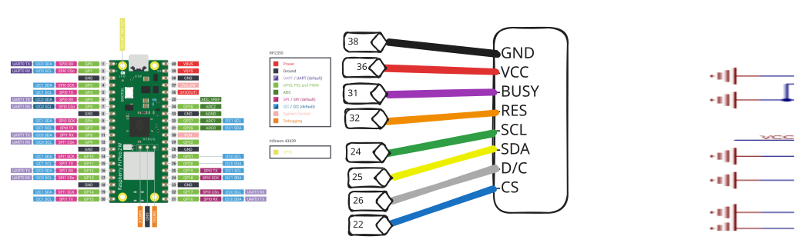

A lightweight framework for interfacing and controlling the **WeAct 3.7" E-Paper Display (E037A75)** using the **Raspberry Pi Pico 2**.

### Technologies

<p align="left">
  
  
  
  
  
</p>

## Hardware Connection

 Example connection diagram for the base product **goldpin** header from the benchmark kit.
 

Fig. 1 - connection diagram

## Raspberry pico 2 USB connection

Create a `udev` rules file in the terminal:

```bash
echo 'SUBSYSTEM=="usb", ATTRS{idVendor}=="2e8a", MODE="0666"' | sudo tee /etc/udev/rules.d/99-pico.rules
```

 Reload the system `udev` rules and trigger the changes:
```bash
sudo udevadm control --reload-rules
sudo udevadm trigger
```

## Test connection

For a simple E-ink connection test, you can check the power converter's operation by toggling it ON and OFF in a timed loop `power_conv.c`.


```c
int main(void) {
    stdio_init_all();
    sleep_ms(2000);

    spiInitCustom();
    gpioInitCustom();
    display_reset();
    configureBoosterUC8253();

    sleep_ms(10000); // wait for serail monitor 9600
    printf("[INFO] Finish initialized!\n");
    printf("V:0.0.1c\n");
    printf("=== UC8253 (240x416) - STATUS TEST WITH CONVERTER CONFIGURATION ===\n");

    uint8_t s;
    while (1) {
        powerOnBooster();
        sleep_ms(2000);

        printStatus("Po Power ON (0x04) ", readStatus_0x71());
        sleep_ms(2000);

        powerOffBooster();
        sleep_ms(2000);

        printStatus("Po Power OFF (0x02)", readStatus_0x71());
        sleep_ms(2000);
    }
    return 0;
}
```

Serial monitor expected output (115200 baud):
```
Po Power ON  (0x04):  0x15 | BIN: 00010101 (PON=0)
Po Power OFF (0x02): 0x13 | BIN: 00010011 (PON=0)
```

## Problems checklist
-[] Jumper wires problems
-[] A short circuit block RP pico2 bootlooder and normal operation.

